

  

  

  
  
  
  
  

<table>
<tr>
<td width="50%"><a href="https://github.com/foxploit/gtx-trading-api-security-review">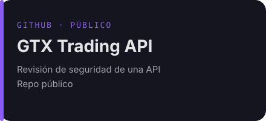</a></td>
<td width="50%"><a href="https://github.com/foxploit/writeups">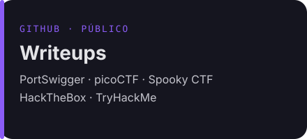</a></td>
</tr>
<tr>
<td width="50%"><a href="https://github.com/foxploit/overthewire-solver">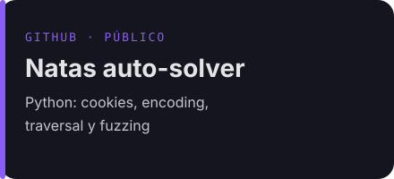</a></td>
<td width="50%"><a href="https://github.com/tailscale/tailscale-android/pull/892">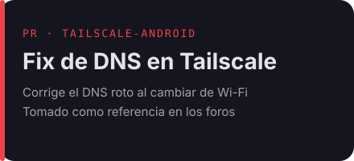</a></td>
</tr>
</table>

<table>
<tr>
<td width="50%">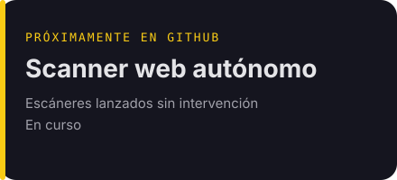</td>
<td width="50%">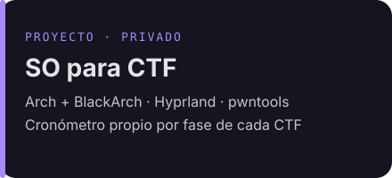</td>
</tr>
<tr>
<td colspan="2">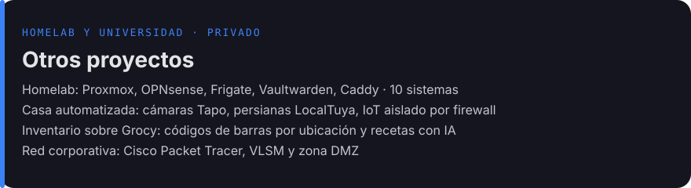</td>
</tr>
</table>

---

<table>
<tr>
<td width="50%">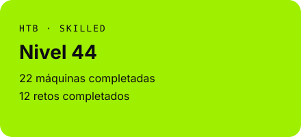</td>
<td width="50%">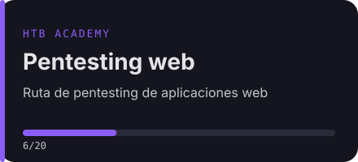</td>
</tr>
<tr>
<td width="50%">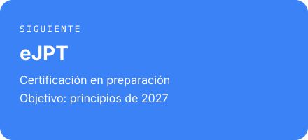</td>
<td width="50%"></td>
</tr>
</table>

## $ stats

<table>
<tr>
<td width="50%"></td>
<td width="50%"></td>
</tr>
</table>

## $ exit 0

> No pentesteo sin permiso por escrito. No desarrollo malware.

rooted by foxploit

